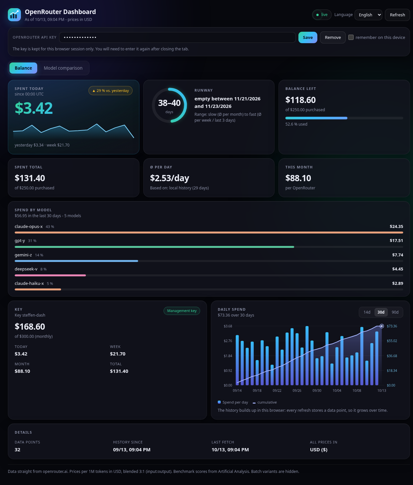
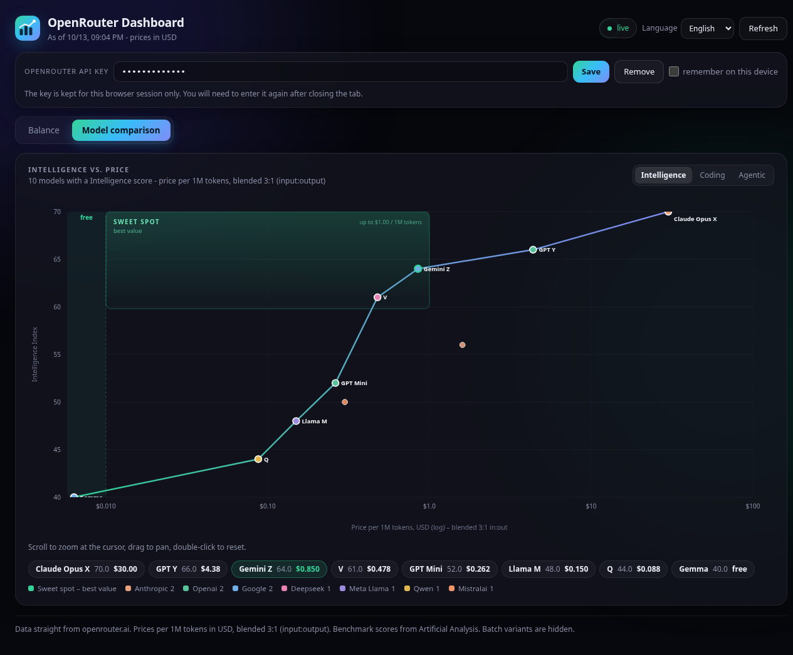

# OpenRouter Dashboard

A small, static dashboard for your [OpenRouter](https://openrouter.ai) account: how much balance is left, how fast you spend it, how long it lasts, what each model costs you, and a price-vs-intelligence comparison of all models.

No server, no build step, no dependencies. Open `index.html` and it runs. Available in **English and German** (switch in the top bar).





> The screenshots use demo data, not a real account.

## Features

**Balance and spend**
- Spent today, with a comparison to yesterday at the same UTC time, plus a sparkline
- Runway as a **range**: slow pace (average per month) to fast pace (average per week or last 3 days), with the dates the balance would run out
- Balance left, total spent, average per day, spend this month
- Key spending limit with remaining amount and reset cycle
- Daily spend chart for 14, 30 or 90 days (bars = per day, line = cumulative)

**Spend by model**
- Top models of the last 30 days with share and amount
- The history is stored locally, so it grows beyond the 30 days the API returns

**Model comparison**
- Price (blended 3:1 input:output, log scale) against Intelligence, Coding or Agentic score
- Pareto frontier, a "sweet spot" pick, zoom and pan

**Design and behaviour**
- Dark theme, View Transitions between tabs and ranges (Chrome, Edge), numbers count up on change
- Refreshes every minute while the tab is visible
- Respects `prefers-reduced-motion`

## Getting started

Option 1: open `index.html` in your browser.

Option 2 (recommended, avoids some browser restrictions on local files):

```bash
python3 -m http.server 8000
# then open http://localhost:8000
```

Paste your OpenRouter API key into the field at the top. The key is used only for requests to `openrouter.ai`.

## API key and security

- **Session by default.** The key is kept in `sessionStorage`. It is gone when you close the tab.
- **"Remember on this device"** also writes the key to `localStorage`. It stays there in **plain text** until you remove it. Any script running on the same origin can read it, so only use this on your own machine.
- **Network.** A Content-Security-Policy meta tag allows scripts and styles from this page only, and network calls only to `openrouter.ai`.
- **Escaping.** Model names from the API are escaped before they go into the page.
- **Clickjacking.** A page framed by another site stays blank. This is a JavaScript guard only. For a hosted deployment, add a `frame-ancestors` response header.
- **Management keys.** Per-model spend comes from the activity endpoint, which needs a **management key**. A management key can do more than read usage, for example manage API keys. Only use one where you trust the browser and the place the page is served from. A regular inference key gets a 403, and the dashboard shows a hint instead of data.

See [SECURITY.md](SECURITY.md) for how to report a vulnerability.

## Data sources

| Endpoint | Used for | Key |
| --- | --- | --- |
| `GET /api/v1/credits` | balance, total spend | API key |
| `GET /api/v1/key` | today, week, month, limit, key name | API key |
| `GET /api/v1/activity` | spend per model per day | management key |
| `GET /api/v1/models` | prices and benchmark scores | none |

Benchmark scores come from Artificial Analysis, as included in the OpenRouter model data.

**Please verify:** the field names of `/api/v1/activity` (`date`, `model`, `usage`) were taken from the OpenRouter documentation and have not yet been checked against a real response. If the per-model section stays empty with a management key, open the browser console and compare the response with what `app.js` expects.

Spend history (balance snapshots and per-model totals) is kept in `localStorage` in your browser. Nothing is sent anywhere else.

## Files

- `index.html` - structure, translation markers, CSP
- `styles.css` - design and animations
- `app.js` - data loading, storage, calculations, charts, translations
- `logo.svg` - logo, also used as favicon
- `docs/` - screenshots

## Known limitations

- Single file for all logic (`app.js`), no automated tests. Tested manually in Chrome with demo data.
- Browsers without View Transitions (for example older Firefox versions) switch tabs and ranges instantly. Everything else works.
- Benchmark scores and prices depend on what OpenRouter's model catalogue provides.

## License

[MIT](LICENSE)
